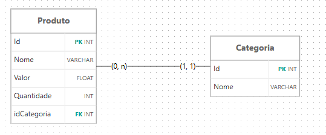

# Avaliacao_Pratica-Backend_API

## DER



## Como executar

Abra o terminal na pasta **backend**;

No terminal digite **npm init -y**;

Quando terminar de instalar, digite **npm i express node nodemon mysql2 dotenv**;

Crie o arquivo **.env**;

No arquivo **.env**, você deve preencher esses parâmetros:

| Dados | Descrição |
|---|---|
| DB_HOST= | Host do servidor |
| DB_USER= | Usuário do banco de dados |
| DB_PASSWORD= | Senha do banco de dados |
| DB_PORT= | Porta do banco de dados |
| DB_NAME= | Nome do banco de dados |
| API_PORT= | Porta usada para rodar as rotas |

Depois de terminar tudo, pode dar um **npm start**;

## Mapa da API

```text
backend/
├── src/
│   ├── config/
│   │   ├── db.js        # Conexão com o banco de dados.
│   │   └── script.sql   # Script do banco de dados.
│   ├── controllers/     # Lógica de controle e respostas.
│   ├── models/          # Camada de acesso aos dados.
│   ├── routes/          # Definição de rotas dos endpoints.
│   └── server.js        # Configuração do express e inicialização do servidor.
├── .env.example         # Exemplo das váriaves do ambiente.
└── package.json
```

## Rotas

`Produtos`

| Método | Rota | Descrição |
|---|---|---|
| GET | `/produto/` | Lista produtos |
| GET | `/produto/estoque_minimo` | Busca produtos com poucas unidades |
| GET | `/produto/estoque_zerado` | Busca produtos que estão zerados no estoque |
| GET | `/produto/:id` | Busca produtos por ID |
| POST | `/produto/` | Criar um produto |
| PUT | `/produto/:id` | Atualiza produto |
| DELETE | `/produto/:id` | Deleta produto |

**Exemplo de corpo (POST/PUT)**
```json
{
    "id": 1,
    "nome": "Notebook",
    "valor": 2500,
    "quantidade": 45,
    "idCategoria": 1
}
```

`Categoria`

| Método | Rota | Descrição |
|---|---|---|
| GET | `/categoria/` | Lista categorias |
| GET | `/categoria/:id` | Busca categoria por ID |
| POST | `/categoria/` | Criar categoria |
| PUT | `/categoria/:id` | Atualiza categoria |
| DELETE | `/categoria/:id` | Deleta categoria |

**Exemplo de corpo (POST/PUT)**
```json
{
    "Id": 1,
    "nome": "Técnologia"
}
```